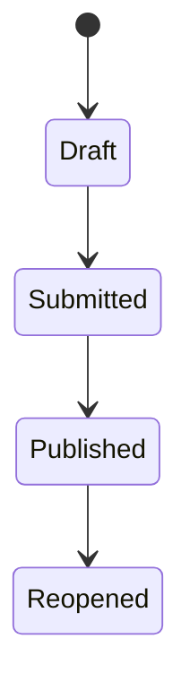

## TEST DESIGNS
Feature: Paper with questions & maximum marks. Section B = "answer any 2 of 4", best 2 count. Marks in 0.5 steps. Teacher can edit marks until published; after publish, changes need approval. Student sees results only after publish.

I used four test design techniques: Boundary Value Analysis, Equivalence Partitioning, Decision Table Testing and State Transition Testing.

I designed 45 test cases covering marks validation, best-two calculation, result publication, student visibility and teacher approval workflows.

I selected five high-priority test cases to cover the most critical requirements within a limited testing time.

## 1. Objective

To design test cases for an examination result system before development begins.

### Requirements

1. Each question has maximum marks.
2. Section B contains 4 questions. Students must answer any 2.
3. Only the best 2 answers are considered for the final score.
4. Marks must be entered in increments of 0.5.
5. Teachers can edit marks before results are published.
6. After publication, changes require approval.
7. Students can view results only after publication.

---

## 2. Testing Techniques

### 2.1 Boundary Value Analysis (BVA)

Boundary Value Analysis is used to test values at the minimum and maximum limits.

**Example:** Maximum marks = 10.

| Test Value | Expected Result |
|---|---|
| 0 | Accepted |
| 0.5 | Accepted |
| 10 | Accepted |
| 10.5 | Rejected |
| 4.25 | Rejected |

### 2.2 Equivalence Partitioning (EP)

Equivalence Partitioning divides input values into groups that are expected to behave similarly.

| Equivalence Class | Example | Expected Result |
|---|---|---|
| Valid marks | 3 | Accepted |
| Valid decimal marks | 5.5 | Accepted |
| Negative marks | -2 | Rejected |
| Above maximum marks | 12 | Rejected |
| Invalid increment | 3.25 | Rejected |
| Blank input | Empty | Requires clarification |

### 2.3 Decision Table Testing

Decision Table Testing checks different combinations of conditions and their expected results.

**Example:** Section B contains four questions, and only the best two answers should count.

| Combination | Q1 | Q2 | Q3 | Q4 | Expected Result |
|---|---|---|---|---|---|
| 1 | Answered | Answered | No | No | Count Q1 + Q2 |
| 2 | Answered | No | Answered | No | Count Q1 + Q3 |
| 3 | Answered | No | No | Answered | Count Q1 + Q4 |
| 4 | No | Answered | Answered | No | Count Q2 + Q3 |
| 5 | No | Answered | No | Answered | Count Q2 + Q4 |
| 6 | No | No | Answered | Answered | Count Q3 + Q4 |
| 7 | Answered | Answered | Answered | No | Count best 2 |
| 8 | Answered | Answered | No | Answered | Count best 2 |
| 9 | Answered | No | Answered | Answered | Count best 2 |
| 10 | No | Answered | Answered | Answered | Count best 2 |
| 11 | Answered | Answered | Answered | Answered | Count best 2 |

### 2.4 State Transition Testing

State Transition Testing checks how the system behaves when it moves from one state to another.

**State Transition Diagram:**

| State | Expected Behaviour |
|---|---|
| Draft | Teacher can edit marks directly |
| Submitted | Results are submitted but not yet published |
| Published | Students can view results; changes require approval |
| Reopened | Results have been reopened; editing rules need clarification |

---

## 3. Test Cases

### Severity Levels

- **Critical:** Very serious issue affecting important functionality.
- **High:** Major functionality is affected.
- **Medium:** Moderate impact.
- **Low:** Minor impact.

### Priority Levels

- **P1:** Fix immediately.
- **P2:** Fix soon.
- **P3:** Can be fixed later.

### 3.1 Boundary Value Analysis Test Cases

| ID | Test Steps | Expected Result | Severity | Priority |
|---|---|---|---|---|
| TC001 | Enter 0 marks for a question with maximum 10 | System accepts 0 marks | Medium | P1 |
| TC002 | Enter 0.5 marks | System accepts 0.5 marks | Medium | P1 |
| TC003 | Enter 10 marks when maximum is 10 | System accepts 10 marks | High | P1 |
| TC004 | Enter 10.5 marks when maximum is 10 | System rejects the marks | High | P1 |
| TC005 | Enter 4.25 marks | System rejects invalid increments | Medium | P1 |
| TC006 | Enter 9.5 marks when maximum is 10 | System accepts the marks | Medium | P2 |
| TC007 | Enter 0.25 marks | System rejects invalid increments | Medium | P2 |
| TC008 | Enter -0.5 marks | System rejects negative marks | High | P1 |

### 3.2 Equivalence Partitioning Test Cases

| ID | Test Steps | Expected Result | Severity | Priority |
|---|---|---|---|---|
| TC009 | Enter valid marks such as 3 | System accepts the marks | Medium | P1 |
| TC010 | Enter valid decimal marks such as 5.5 | System accepts the marks | Medium | P1 |
| TC011 | Enter negative marks such as -2 | System rejects the marks | High | P1 |
| TC012 | Enter marks above the maximum, such as 12 | System rejects the marks | High | P1 |
| TC013 | Enter invalid decimal marks such as 3.25 | System rejects the marks | Medium | P1 |
| TC014 | Leave the marks field empty and submit | System displays appropriate validation | Medium | P2 |
| TC015 | Enter alphabetic characters in the marks field | System rejects non-numeric input | Medium | P2 |
| TC016 | Enter special characters in the marks field | System rejects invalid input | Medium | P2 |
| TC017 | Enter valid marks for multiple students | System saves each student's marks correctly | High | P2 |

### 3.3 Decision Table Test Cases

| ID | Test Steps | Expected Result | Severity | Priority |
|---|---|---|---|---|
| TC018 | Answer Q1 and Q2 only | System counts Q1 and Q2 | High | P1 |
| TC019 | Answer Q1 and Q3 only | System counts Q1 and Q3 | High | P1 |
| TC020 | Answer Q1 and Q4 only | System counts Q1 and Q4 | High | P1 |
| TC021 | Answer Q2 and Q3 only | System counts Q2 and Q3 | High | P1 |
| TC022 | Answer Q2 and Q4 only | System counts Q2 and Q4 | High | P1 |
| TC023 | Answer Q3 and Q4 only | System counts Q3 and Q4 | High | P1 |
| TC024 | Answer all four questions with marks 5, 4, 3 and 2 | System counts only 5 + 4 = 9 | Critical | P1 |
| TC025 | Answer three questions with marks 2, 4 and 3 | System counts only 4 + 3 = 7 | Critical | P1 |
| TC026 | Answer all four questions with equal marks | System counts only two answers | Medium | P2 |
| TC027 | Answer only one question | System follows the defined validation rule | High | P1 |
| TC028 | Leave all four questions unanswered | System follows the defined validation rule | High | P1 |
| TC029 | Change one answer's marks after calculation | System recalculates the best two scores correctly | High | P1 |

### 3.4 State Transition Test Cases

| ID | Test Steps | Expected Result | Severity | Priority |
|---|---|---|---|---|
| TC030 | Open a newly created result | Result is in Draft state | Medium | P2 |
| TC031 | Change marks while result is in Draft | System allows direct editing | High | P1 |
| TC032 | Submit a Draft result | Result moves to Submitted state | High | P1 |
| TC033 | Check whether students can view Submitted results | Students cannot view results | Critical | P1 |
| TC034 | Publish a Submitted result | Result moves to Published state | Critical | P1 |
| TC035 | Check whether students can view Published results | Students can view results | Critical | P1 |
| TC036 | Teacher changes marks after publication | System requests approval | Critical | P1 |
| TC037 | Try changing published marks without approval | System does not apply the change | Critical | P1 |
| TC038 | Submit a change request for published marks | System records the approval request | High | P2 |
| TC039 | Check result visibility after reopening | System follows the defined reopening visibility rule | High | P2 |
| TC040 | Try to publish a result before submission | System prevents an invalid state transition | High | P2 |

## 4. Top 5 Test Cases to Run First

If I have only 10 minutes to test the application, I would run these five test cases first.
# Top 5 Test Cases — Run First (10-Minute Window)

> Only the 5 tests I'd run first, with plain-English reasons. Copy-paste ready.

| # | Test ID | Test Case | Steps | Expected Result | Severity | Priority | Why run first  |
|---|---------|-----------|-------|-----------------|----------|----------|-------------------------------|
| 1 | **TC-019** | Best-2-of-4 scoring (full marks present) | Student answers 4 B questions with marks `9, 2, 8, 1`; open result | Section score = **9 + 8 = 17** (best two only) | Critical | P1 | This is the **core rule of the whole feature** — if it's wrong, every student's grade is wrong. The marks are chosen so a broken system that sums all, sums the first two, or sums the last two will give a *different* number, so one run catches several bugs at once. |
| 2 | **TC-020** | Only 2 answered (minimum valid) | Student answers exactly 2 B questions with marks `5, 7`; open result | Section score = **12** | Critical | P1 | The **simplest happy path**. It proves the system can add two marks correctly *before* any "pick the best 2" logic kicks in. If this fails, nothing else matters. |
| 3 | **TC-004** | Mark above maximum rejected | Teacher enters `10.5` for a 10-mark question; save | **Rejected** with a clear "mark must be between 0 and 10 in 0.5 steps" error | Critical | P1 | The **most common bug** in any marks field is a missing upper-bound check. It takes 5 seconds to test and protects against impossible grades leaking into results. |
| 4 | **TC-031** | Edit a published mark without approval | Publish results, then try to change a mark without going through approval | **Blocked** with "approval required" message | Critical | P1 | A **compliance and trust guard**. If anyone can silently change a grade after publishing, the school has no audit trail and students can't trust their results. High damage, fast to check. |
| 5 | **TC-034** | Student cannot see results before publish | Keep paper in `SUBMITTED` (not yet published); log in as student and open results | Results are **hidden / not visible** | Critical | P1 | A **privacy guard**. If unpublished marks leak to students, it causes panic, complaints, and reputational damage. One login + one look confirms it. |

---

### Why these five together

> "In 10 minutes I can't test deeply, so I test **breadth of risk**. These five cover the five things that would hurt most if broken: **the scoring rule, the basic happy path, input validation, the approval guard, and student privacy.** Each is a single input-and-observe, so all five fit the window. TC-019 comes first because it is the rule every student's grade depends on."

---

## 5. Clarifications Required

Before finalizing the test cases, I would ask the developer or product owner:

1. What should happen if a student answers fewer than two questions?
2. What should happen if two or more questions have equal marks?
3. Who can approve changes to published marks?
4. Who is allowed to reopen published results?
5. Can teachers directly edit marks after results are reopened?
6. Should students continue seeing results while they are reopened?

---

